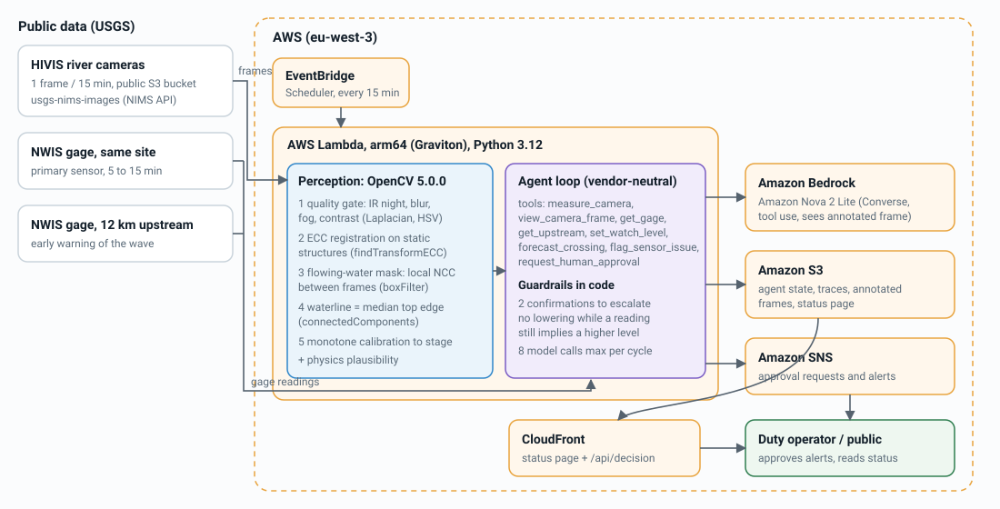

# RiverWatch

**Camera-based flood watch for low-water crossings.** RiverWatch reads the river stage from existing USGS river
cameras with **OpenCV 5**, cross-checks it against official gages, and an **Amazon Nova** agent decides what to do
next: look more often, flag a broken sensor, or ask a human operator to close the crossing.

- Live status page: https://d206jwadatehui.cloudfront.net
- Code: https://github.com/crjstobal/riverwatch
- Built for the OpenCV AI Competition 2026, powered by AWS (overall track and Agentic Vision award).

> Research prototype, not an official warning service. Thresholds follow NWS "Turn Around, Don't Drown" guidance.

## Why

Over half of flood drownings in the US happen when a vehicle is driven into flood water (CDC, via NWS): 12 inches
of rushing water can carry away most cars, 2 feet can carry away SUVs and trucks. Thousands of crossings have no gage; the gages that exist fail exactly when they are needed (sensors
silted, washed out, stuck). The USGS already runs more than 1,300 river cameras whose images nobody measures.

## Results (Cowhouse Creek at W Range Rd, Fort Hood, TX, USGS 08101300)

| | |
|---|---|
| Frames processed | 3,936 (2026-09-09 to 2026-10-20, one every 15 min) |
| Protocol | blocked cross-validation by day: each day predicted with a calibration fitted on the other days |
| Stage error when water flows (daytime, held out) | MAE 0.67 ft (20 cm), 87% of readings within ±1 ft |
| "Crossing under 1 ft of water" from the camera alone | precision 97%, recall 84% (vision + physics check: 100% / 87%) |
| Replay of the 2026-10-02 flash flood | close-crossing requested 20 min after the gage crossed 1 ft over the deck, danger 15 min after 2 ft; never relaxed during the flood |
| Agent scenario tests (8 scenarios x 3 runs, faults injected) | 23 / 24 passed (failure analysed in the report) |
| Live finding, 2026-10-25 | the official gage's primary sensor is silent and its secondary sensor is stuck at 6.2 ft; the camera shows a dry crossing and the agent flags the gage instead of raising an alert |

Full numbers: `data/eval/<camera>/summary.json`, `data/eval/agent_scenarios.json`. Technical report: `docs/report.md`.

## How it works



**Perception (OpenCV 5.0.0, `riverwatch/vision.py`)**, classical computer vision, no learned weights:

1. Quality gate: infrared night mode (HSV saturation), blur (variance of the Laplacian), fog / glare (RMS contrast).
2. Registration: `findTransformECC` (Euclidean) against the calibrated view, using only static structures
   (bridge, piers, banks) as the input mask so a flood does not drag the alignment.
3. Flowing water: local normalized cross-correlation (box filters) between two registered frames 15 min apart.
   A flood surface decorrelates everywhere and is smooth; sunlit gravel with moving shadows decorrelates only in parts
   and is rough. Each candidate body (`connectedComponentsWithStats`) is kept only if it is dense and smooth.
4. Waterline: median top edge of the water body across the channel columns, a "virtual staff gauge".
5. Stage: robust monotone calibration `stage = a + b·exp(c·h)`, fitted on frames with a known stage; readings far
   above the calibrated range are flagged instead of extrapolated. A physics check holds implausible jumps.

**Decision and action (`riverwatch/agent.py`)**: a vendor-neutral tool-use loop; `riverwatch/bedrock.py` is the only
module that knows the model (Amazon Nova 2 Lite via the Bedrock Converse API). Tools: `measure_camera`,
`view_camera_frame` (the model sees the OpenCV-annotated frame), `get_gage`, `get_upstream`, `set_watch_level`,
`flag_sensor_issue`, `request_human_approval`. What OpenCV measures changes what happens next: the sampling cadence
(15 / 30 / 60 min), which source the agent trusts, sensor fault reports, and requests to the operator.

**Human control, enforced in code, not only in the prompt:**
- Raising the public alert always needs the duty operator (`/api/decision`, operator code).
- Escalating to "close crossing" or "danger" needs two independent readings in the last 30 min.
- An alert cannot be lowered while a recent trusted reading still implies a higher level.
- At most 8 model calls per cycle; every cycle is traced to S3 and shown on the status page.

**AWS**: Lambda (arm64 / Graviton, Python 3.12) runs OpenCV and the agent, triggered every 15 min by EventBridge
Scheduler; frames are read from the USGS public S3 bucket; state, traces and annotated frames in S3; status page and
API through CloudFront; Bedrock (Nova 2 Lite) for decisions; SNS for operator notifications. Infrastructure:
`template.yaml` (AWS SAM).

## Repository layout

```
riverwatch/vision.py     OpenCV 5 perception
riverwatch/physics.py    plausibility filter
riverwatch/agent.py      agent loop, tools, guardrails
riverwatch/bedrock.py    Amazon Bedrock adapter
riverwatch/usgs.py       USGS NIMS (cameras) and NWIS (gages) access with a simulated clock
lambda_function.py       AWS Lambda entry point (schedule + operator API)
template.yaml            AWS SAM stack
web/                     status page (no dependencies)
tools/                   data download, evaluation, replay, publishing
profiles/<camera>/       calibrated camera profile (channel polygon, reference view, calibration)
cameras.json             camera configuration, crossing deck and alert thresholds
```

## Reproduce

Requirements: Python 3.12+, `pip install -r requirements.txt` (pinned: `opencv-python-headless==5.0.0.93`).

```bash
# 1. data (public USGS, no key): frames + gage for the evaluation window
python tools/download.py TX_Cowhouse_Ck_at_W_Range_Rd_nr_Ft_Hood 2026-09-10 2026-10-20

# 2. vision evaluation (about 4 min on a laptop): writes data/eval/<camera>/summary.json and timeseries.png
python tools/evaluate.py TX_Cowhouse_Ck_at_W_Range_Rd_nr_Ft_Hood

# 3. production calibration
python tools/make_profile.py TX_Cowhouse_Ck_at_W_Range_Rd_nr_Ft_Hood

# 4. agent (needs AWS credentials with Bedrock access to Amazon Nova in eu-west-3)
python tools/eval_agent.py 3
python tools/replay.py TX_Cowhouse_Ck_at_W_Range_Rd_nr_Ft_Hood 2026-10-02T12:00:00Z 2026-10-03T02:00:00Z flood-2026-10-02
```

Deploy (needs permission to create one IAM role):

```bash
./build.sh                                   # pinned manylinux aarch64 wheels, no Docker
sam deploy --stack-name riverwatch --region eu-west-3 --resolve-s3 --capabilities CAPABILITY_IAM \
  --parameter-overrides OperatorCodeSha256=$(printf %s "$CODE" | shasum -a 256 | cut -d' ' -f1) AlertEmail=you@example.com
python tools/publish_site.py <BucketName output>
```

## Limitations

- Validated on one camera. The two water-body thresholds (density 0.92, texture 14) were chosen on samples from this
  camera, including days that are later scored, so the precision figure is optimistic for a new site.
- Needs flowing water and daylight: night infrared frames are rejected; the camera cannot resolve stage below about
  3.8 ft at this site (no flow across the channel).
- A new camera needs a channel polygon and a calibration from a gage or a few manual readings.
- Above the highest calibrated water the camera underestimates; such readings are flagged and the agent relies on the
  gage. The replayed flood (peak 11.7 ft) was not seen during calibration.
- Requires at least one frame every 15 to 20 minutes (many HIVIS cameras are hourly).

## Responsible use

Public data only (USGS imagery and gage records, public domain); no people are identified or tracked. The system
never publishes an alert by itself. Every decision is traceable (inputs, tool calls, outputs) and kept 90 days.

## License

MIT, see `LICENSE`.
