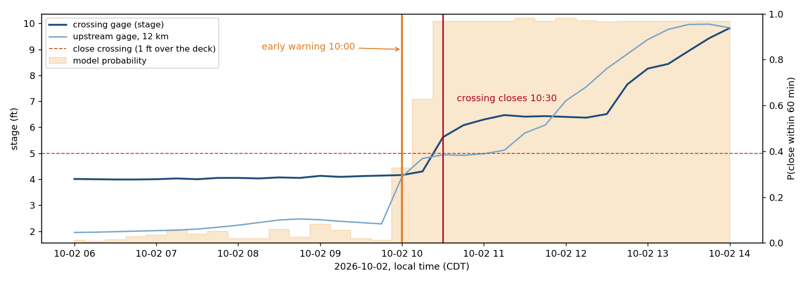
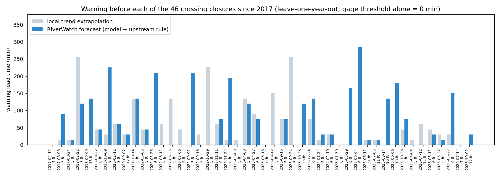

# RiverWatch: camera-based flood watch for low-water crossings

Technical report, OpenCV AI Competition 2026 powered by AWS. Live system: https://d206jwadatehui.cloudfront.net

## 1. Problem

Over half of all flood-related drownings in the United States occur when a vehicle is driven into hazardous flood
water (CDC, cited by the National Weather Service). The NWS "Turn Around, Don't Drown" guidance: 6 inches of
fast-moving water can knock over an adult, 12 inches can carry away most cars, 2 feet can carry away SUVs and trucks.
A low-water crossing can go from dry to deadly in minutes during a flash flood, often before anyone closes it.

Two gaps make this hard:

1. **Coverage.** Thousands of crossings have no gage. Gages are expensive to install and maintain.
2. **Reliability.** The gages that exist fail when they matter most: sensors silt up, get washed out or stick. We
   observed this live: on 2026-10-25 the USGS gage at our study site had a silent primary sensor and a secondary sensor
   stuck at 6.2 ft for weeks (it also read 6.2 ft during the 11.7 ft flood peak of 2026-10-02).

Meanwhile the USGS already operates more than 1,300 river cameras (HIVIS), many at gaged sites, publishing a frame
every 15 to 60 minutes to a public S3 bucket. Nobody measures those images.

## 2. Users

- **Road and emergency managers** (county road departments, military range control at Fort Hood, city flood teams):
  need to know when to close a crossing, with evidence, without watching dozens of feeds.
- **Hydrologists running gage networks**: an independent check that flags silent or stuck sensors.
- **The public**: a clear "crossing open / closed" status.

RiverWatch never closes a crossing or publishes an alert by itself: a duty operator approves every public change.

## 3. System overview

Every 15 minutes an EventBridge schedule invokes a Lambda function (arm64 / Graviton, Python 3.12). For each
watched camera whose next check is due (the agent chooses the interval), the function reads the two newest frames
from the USGS public S3 bucket, runs the OpenCV 5 perception pipeline, and runs one agent cycle with Amazon Nova 2 Lite
on Amazon Bedrock. State, traces and annotated frames go to S3; the status page and the operator API are served by
CloudFront; approval requests and approved alerts go out through SNS.

Study site: Cowhouse Creek at W Range Rd near Fort Hood, TX (USGS 08101300). The camera looks along the creek
from under the bridge of a low-water military crossing whose deck sits at stage 3.99 ft. Alert levels follow the NWS figures as
depth over the deck: caution at 0.5 ft (stage 4.5), close crossing at 1 ft (5.0), danger at 2 ft (6.0). An upstream
gage 12 km away (Cowhouse Ck at Pidcoke, 08101000) gives early warning.

## 4. OpenCV 5 implementation (`riverwatch/vision.py`)

Classical computer vision, no learned weights, OpenCV 5.0.0 (`opencv-python-headless==5.0.0.93`) both locally and
in Lambda (manylinux aarch64 wheel).

**4.1 Quality gate.** Mean HSV saturation below 5 means the camera switched to infrared (night): water texture is
not visible, the frame is rejected. Variance of the Laplacian detects blur (water on the lens, defocus); RMS contrast
detects fog, condensation and glare. A rejected frame gives the agent no river information, and the agent is told why.

**4.2 Registration.** `cv::findTransformECC` with a Euclidean model, on a half-resolution level, against the
calibrated reference view. The input mask excludes the dilated channel so the alignment uses only static structures
(bridge, piers, banks, ramp); without it, a flood changes so much of the scene that the alignment fails. A correlation
below 0.70 marks the frame as "view does not match the calibrated camera".

**4.3 Flowing-water mask.** Local normalized cross-correlation between the current frame and the frame 15 minutes
earlier (both registered), computed for every pixel with box filters (`cv::boxFilter`), equivalent to
`TM_CCOEFF_NORMED` evaluated densely. Flowing water decorrelates; banks, piers and debris do not. After morphology,
`cv::connectedComponentsWithStats` gives candidate bodies, and each is tested: a flood surface decorrelates almost
everywhere (density ≥ 0.92) and is smooth (mean local standard deviation ≤ 14 in 9×9 windows). Sunlit gravel under a
moving shadow decorrelates only along shadow edges and is rough; this test removed most false alarms.

We tried and rejected two simpler approaches, and report them because they explain the design:
- *Wetted area against dry references* (NCC to dry frames at several hours): rank correlation with stage 0.17.
- *Water colour model* (histogram back-projection, `cv::calcBackProject`): turbid flood water and dry limestone sand
  have almost the same hue and saturation at this site.

**4.4 Waterline, a virtual staff gauge.** For every column of the channel polygon, the top edge of the water body;
the median over columns gives the waterline height `h` in [0, 1]. As the creek rises, the far edge of the water climbs
the far bank and the debris on the back piers. Daytime correlation between `h` and the official stage above 5 ft: 0.93.

**4.5 Calibration and plausibility.** `stage = a + b·exp(c·h)` with b, c > 0, fitted robustly (grid over c, least
squares, drop residuals above 1.5 ft, refit). The convex shape matches a bank that steepens with height and lets the
model extrapolate a little; readings more than 0.08 above the highest calibrated waterline are flagged
`above_range` instead of extrapolated. Below about 3.8 ft no water flows across the channel and the camera reports
"at or below the floor". A causal physics check holds readings that imply a rise faster than 8 ft/h.

## 5. Agent (`riverwatch/agent.py`, `riverwatch/bedrock.py`)

A vendor-neutral tool-use loop; only `bedrock.py` knows the model (Bedrock Converse API, Amazon Nova 2 Lite,
temperature 0.1, at most 8 model calls per cycle). Each cycle starts with a context message (time, thresholds,
current alert, pending request, recent readings, previous summary). Tools:

| Tool | Effect |
|---|---|
| `measure_camera` | runs section 4 on the newest (or an older) frame pair; returns stage, quality, `alert_level_implied` computed in code |
| `view_camera_frame` | the model sees the OpenCV-annotated frame (water in blue, waterline in yellow) |
| `get_gage` | official primary sensor at the site; reports a silent primary and lists other sensors as not usable for alerts |
| `get_upstream` | gage 12 km upstream and its trend |
| `forecast_crossing` | probability that the crossing closes within 60 min and whether the early warning fires (section 7.4) |
| `set_watch_level` | normal / elevated and the next check interval: 15, 30 or 60 min |
| `flag_sensor_issue` | maintenance record for the camera or the gage |
| `request_human_approval` | asks the duty operator to change the public alert, with reason and evidence |

**How the visual evidence changes what happens next.** An unusable frame makes the agent fall back to the gage and
upstream site; a rising camera stage tightens the sampling cadence from 60 to 15 minutes; a disagreement with the
gage makes the agent look at the frame and decide which source to trust (or flag one); a forecast warning makes
it issue an early caution request before the water arrives; an implausible or above-range
reading is held until confirmed; two readings at or above a level trigger a request to the operator.

**Guardrails in code, not only in the prompt.** (1) Escalating to close_crossing or danger requires two independent
readings at or above that level in the last 30 minutes; when blocked, the tool returns the level that is already
supported and the agent can request that instead. (2) The alert cannot be lowered while a recent trusted reading still
implies a higher level. (3) No duplicate requests. (4) The public alert changes only through `/api/decision` with the
operator code (stored in AWS SSM, only its hash reaches the stack).

Two failures found during development shaped this design: Nova 2 Lite compared a 5.62 ft reading with the 5.0 ft
threshold and requested "caution" (so alert levels are now computed in code), and once requested a lower alert from a
single low camera reading while the gage still read danger (so lowering is now guarded in code).

## 6. AWS deployment

| Component | Role |
|---|---|
| AWS Lambda, arm64 (Graviton), 2 GB, Python 3.12 | OpenCV 5 perception and the agent loop; 125 MB package of pinned manylinux aarch64 wheels, no container |
| Amazon EventBridge Scheduler | every 15 min; the function skips cameras whose agent-chosen interval has not elapsed |
| Amazon Bedrock | Amazon Nova 2 Lite through the `eu.` cross-region inference profile |
| Amazon S3 | agent state, per-cycle traces (90-day lifecycle), annotated frames, status page |
| Amazon CloudFront | status page (origin access control, bucket not public) and `/api/*` to the Lambda function URL |
| Amazon SNS | approval requests and approved alerts to the operator |
| AWS SSM Parameter Store | operator code (SecureString) |

Infrastructure is one AWS SAM template (`template.yaml`) with a single least-privilege role: its own bucket, its own
topic, and `bedrock:InvokeModel` on the Nova inference profile. Reproducible build: `build.sh`.

Observability: every cycle stores the full trace (context, each tool call with inputs and outputs, model usage and
latency) in S3, and the status page shows the last trace. CloudWatch Logs receive the function logs.

## 7. Evaluation

### 7.1 Perception against the official gage

Data: 3,936 frames from 2026-09-09 to 2026-10-20 (one every 15 min) and the primary-sensor gage record, which includes
the 2026-10-02 flash flood (4.1 ft to 11.7 ft in five hours). Protocol: blocked cross-validation by calendar day;
each day is predicted with a calibration fitted only on the other days. Scored: usable frames with a gage reading
within 10 min.

| Metric | Value |
|---|---|
| Frames rejected: night infrared | 1,894 (plus the frame after each, which has no valid partner) |
| Frames rejected: view mismatch (dawn, dusk, wind) | 934 |
| Usable daytime frames | 583 |
| Stage error above the camera floor (119 frames) | MAE 0.67 ft (20 cm), RMSE 0.87 ft, bias −0.27 ft |
| Within ±0.5 ft / ±1 ft | 45% / 87% |
| Crossing under ≥ 1 ft of water (stage ≥ 5.0), camera alone | precision 97% (59 TP, 2 FP), recall 84% (11 FN) |
| Same, after the physics check | precision 100% (61 TP, 0 FP), recall 87% |

### 7.2 Replay of the 2026-10-02 flash flood

The real agent re-run over 2026-10-02 12:00 to 2026-10-03 02:00 UTC (07:00 to 21:00 local CDT) on a simulated clock:
real frames, real gage and upstream records, each tool seeing only data up to the simulated time, and a camera
calibration fitted without that day. A simulated operator approves each request about 10 to 15 minutes later.

| Time (CDT) | Official gage | What the agent did |
|---|---|---|
| 07:00 to 08:00 | 4.0 ft, steady | checks every 60 min; camera sees no flow (correct: at or below its floor); forecast 19 to 22% |
| 09:00 | 4.1 ft | forecast 75%: **early caution request** to the operator, checks every 15 min (1 h 25 min before the water covers the crossing) |
| 10:00 | 4.2 ft | upstream gage rose 1.9 ft in 2 h; the forecast warning holds |
| 10:25 | crosses 5.0 ft (1 ft over the deck) | |
| 10:30 | 5.6 ft | requests close_crossing, **blocked** by the two-reading guardrail (only the gage supported it) |
| 10:45 | 6.1 ft | requests **close_crossing** (camera 5.5 ft and gage agree) |
| 11:00 | 6.3 ft | requests **danger** |
| 11:30 | 6.4 ft | camera reports no flow; agent looks at the frame, sees water, flags the **camera** and keeps the alert |
| 12:45 to 21:00 | second surge to the 11.7 ft peak at 15:30, then receding | keeps danger and 15-min checks; camera reads about 2 ft low near the peak (above its calibrated range), agent relies on the gage |

Request latency after the gage crossed each threshold: caution 10 min, close_crossing 20 min, danger 15 min. The
two-reading guardrail cost one cycle for close_crossing; that is the price of not waking an operator on one reading.
An earlier version relaxed to hourly checks at dusk when the camera missed the water; the guardrail on
`set_watch_level` now forbids that and a scenario test covers it.

### 7.3 Agent scenario tests

Nine scenarios placed at real moments of the record (real frames and gage data), with faults injected through the
same tool interfaces used in production; each runs 3 times with Nova 2 Lite (eu.amazon.nova-2-lite-v1:0). Success is checked by
code (`tools/eval_agent.py`). The last column counts runs in which a code guardrail blocked at least one action:
it shows which layer produced the correct outcome.

| Scenario | Situation | Success criterion | Passed | Guardrail acted |
|---|---|---|---|---|
| `rising_flood` | Flash flood rising past the crossing, all sources healthy; a camera reading 15 min earlier is in memory. | requests close_crossing or danger and checks every 15 min | 3/3 | 3/3 |
| `forecast_early_warning` | 15:00 UTC on 2 October: crossing still at 4.16 ft, but the upstream gage just rose 1.9 ft in 2 hours. | issues an early caution warning from the forecast, without closing on a forecast | 3/3 | 0/3 |
| `gage_silent_in_flood` | Same flood, but the official gage returns no data (sensor washed out). | flags the gage and still escalates on two camera readings | 3/3 | 0/3 |
| `stuck_gage_dry_river` | Dry day; the gage is stuck at 6.21 ft (the real secondary-sensor fault seen live on 2026-10-25). | no alert request, gage flagged | 3/3 | 1/3 |
| `night_infrared` | Night after the flood: camera in infrared, gage healthy at about 7.5 ft. | recognises the camera is unusable and relies on the gage | 3/3 | 0/3 |
| `camera_false_spike` | Dry day; the camera tool is forced to report 9.0 ft while gage and upstream are at base flow. | no approved request on a single unconfirmed camera reading | 3/3 | 1/3 |
| `receding_no_premature_clear` | Danger alert active; river receding but gage still at 6.5 ft. | does not stand the alert down while the gage implies danger | 3/3 | 0/3 |
| `camera_misses_flood_at_dusk` | Danger alert active, gage 7.8 ft and falling; at dusk the camera sees no flowing water (real frame). | keeps watching closely, keeps the alert and does not blame the healthy gage | 3/3 | 0/3 |
| `no_duplicate_request` | A close_crossing request is already pending with the operator. | does not file a duplicate close_crossing request | 3/3 | 3/3 |

**27/27 runs passed.** Earlier versions failed in instructive ways, each fixed in code and kept as a test:
relaxing to hourly checks at dusk when the camera missed the water (now guarded), blaming a healthy, falling gage as
"stuck" (now checked against the data), ignoring the forecast warning (the tool now returns an explicit recommended
action), and then over-applying it once the water was already over the crossing (the recommendation now only appears
while no reading has reached caution). A forecast never justifies close_crossing or danger: those still need two real
readings.

### 7.4 Forecast: warning before the water arrives

The agent's `forecast_crossing` tool predicts whether the crossing closes (stage ≥ 5.0 ft) within the next 60 minutes,
from the last 24 hours at the crossing gage and at the upstream gage 12 km away (`riverwatch/forecast.py`).

*Physics first.* Over 36 closures with complete data, the flood wave reaches the crossing a median of about 80 minutes
after the upstream gage (cross-correlation of rises). But in about half of the closures the upstream gage did not rise
before the crossing did: the rain fell on the crossing's own catchment. A forecast from gages can only help in the
first case; the camera's early local detection covers the second.

*Model.* Eight features (depth over the deck, local rises over 15 and 60 min, rise above the 24-hour minimum, upstream
rises over 1, 2 and 4 hours, upstream rise above its minimum) feed a gradient-boosted tree ensemble
(scikit-learn `HistGradientBoostingClassifier`, 300 trees), exported to JSON and evaluated with numpy in Lambda
(verified identical to scikit-learn). The warning fires when the probability is ≥ 0.5 or when the upstream gage rose
≥ 1 ft in 2 hours (a physical rule).

*Data and protocol.* 9.5 years of 15-minute records for both gages (2017-04-12 to 2026-10-24), 46 closures (stage
reaches 5.0 ft after being below 4.5 ft). Leave-one-year-out: every year is predicted by a model trained on the
other years. The lead time of an event is how long before the closure the warning fired (within 6 hours, without
switching off for more than an hour). A warning episode counts against us if the water then stays below the caution
level (4.5 ft) for 3 hours; episodes that end with the water above caution but below 5.0 ft (near misses with the
crossing already under half a foot of water) are reported separately.

| Alarm | Closures warned ahead | ≥ 30 min ahead | Lead median / mean (min) | Warnings with water staying below caution, per year |
|---|---|---|---|---|
| Gage crosses 5.0 ft (no forecast) | 0/46 | 0 | 0 / 0 | 0.0 |
| Local trend extrapolation | 31/46 | 23 | 22 / 41 | 9.7 |
| Upstream rose ≥ 1 ft in 2 h | 8/46 | 8 | 0 / 32 | 0.5 |
| Logistic regression, p ≥ 0.7 | 27/46 | 19 | 15 / 59 | 2.5 |
| **Shipped: boosted trees p ≥ 0.5 or upstream rule** | 32/46 | 28 | 38 / 71 | 3.0 |

The local trend warns often but cries wolf (about 125 warning episodes a year that never reach 5.0 ft).
The shipped forecast warns before 32 of 46 closures, 28 of them at least 30 minutes ahead, with about
3 warnings a year in which the water stays below caution. Counting near misses, it raises
26 warning episodes a year that do not reach 5.0 ft; that is acceptable only because a warning
leads to an early *caution* request and closer checks, never to a closure by itself.

On 2026-10-02 the upstream gage jumped from 2.3 to 4.1 ft between 09:45 and 10:00 local time; the warning fired at
10:00 and the crossing closed at 10:25.

Limitations: the deck level (3.99 ft) is known from the 2026 sensor only; base flow in earlier years sat 0.3 to 0.5 ft
higher, so older closures may be slightly misdated. No rainfall input yet (the precipitation gages at both sites
start in June 2026).

### 7.5 Cost

Replay of 51 cycles: 217 model calls, 718k input tokens (about 14k input tokens per cycle, mostly the
tool schemas, the context and one 640×480 frame when the agent looks), mean 4.1 s per cycle. In normal weather the
agent checks hourly, so one camera costs about 24 cycles a day. Lambda runs about 5 s per cycle at 2 GB on arm64.

## 8. Limitations

- **One camera.** The two water-body thresholds (density 0.92, texture 14) were chosen by inspecting false and true
  detections from this camera, including days that are later scored. The 97% precision is therefore optimistic for a
  new site; the cross-validation protects the calibration, not these two hyperparameters.
- **Daylight and flow only.** Night infrared frames are rejected; the camera cannot resolve stage below about 3.8 ft
  at this site; standing water (lakes, backwater) does not decorrelate and is not detected.
- **Range.** Above the highest calibrated water the camera underestimates (about 2 ft low at the 11.7 ft peak with the
  flood day held out). Such readings are flagged; the agent relies on the gage.
- **Cadence.** The method needs two frames at most 20 minutes apart; many HIVIS cameras publish hourly.
- **Setup per camera.** A channel polygon and a calibration from gage history or a few manual readings.
- **Latency.** The two-confirmation guardrail costs up to one cycle (15 min) before close_crossing is requested.
- **Model.** Nova 2 Lite is not deterministic and is weak at arithmetic; thresholds and guardrails are therefore
  implemented in code and tested with repeated runs. Its free-text summary can still be wrong (one scenario run); the
  alert badge, not the summary, is authoritative.

## 9. Responsible use

- **Human in control.** The system proposes; a duty operator decides. Every request carries its evidence and sources.
- **No surveillance.** Inputs are public USGS imagery of river channels; no person or vehicle is detected, identified
  or tracked, and frames are not stored beyond the annotated status images and replay.
- **Honest uncertainty.** Unusable frames are reported as such; above-range readings are flagged, not extrapolated;
  the status page states it is a research prototype and not an official warning service.
- **Failure transparency.** Sensor disagreements are logged as maintenance issues, not silently resolved.
- **Security.** Private bucket behind CloudFront origin access control; operator code kept in SSM, only its hash in
  the stack; least-privilege role; model calls capped per cycle.

## 10. Reproducibility

`README.md` lists the exact commands. All data are public (USGS NIMS and NWIS, no key). Dependencies are pinned in
`requirements.txt` and `requirements-lambda.txt`. The evaluation outputs used in this report are in `data/eval/` and
`data/replay/`.
